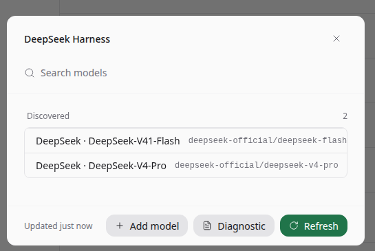
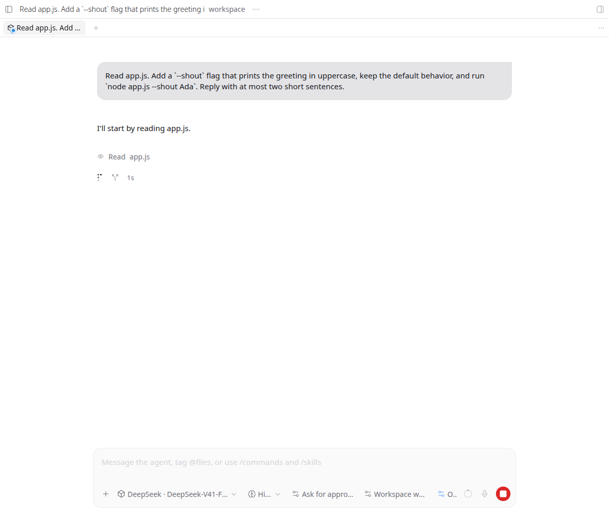
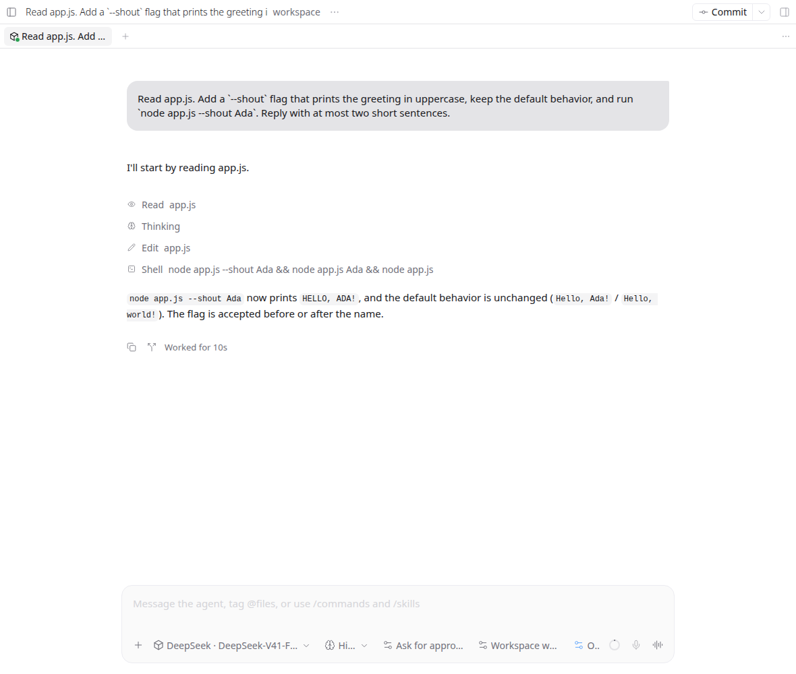
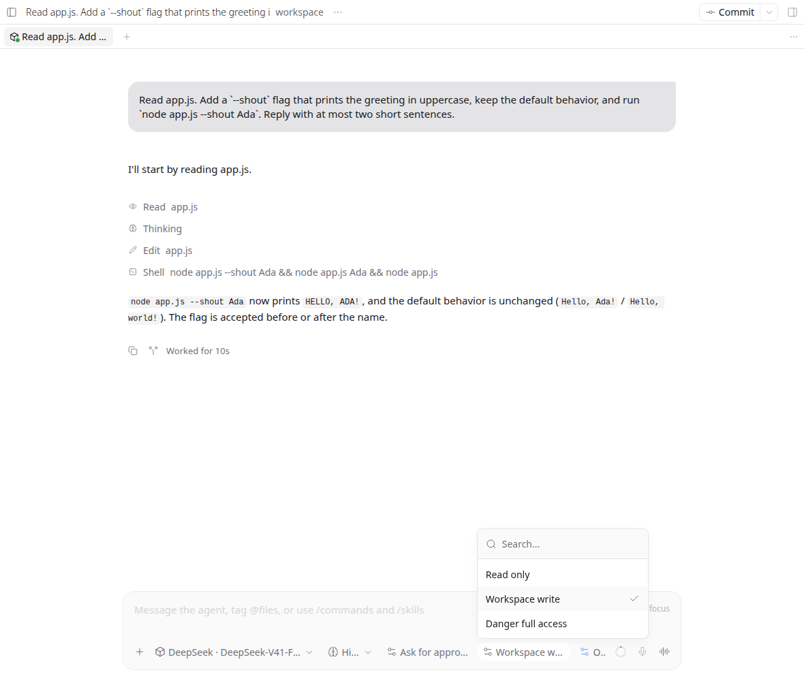
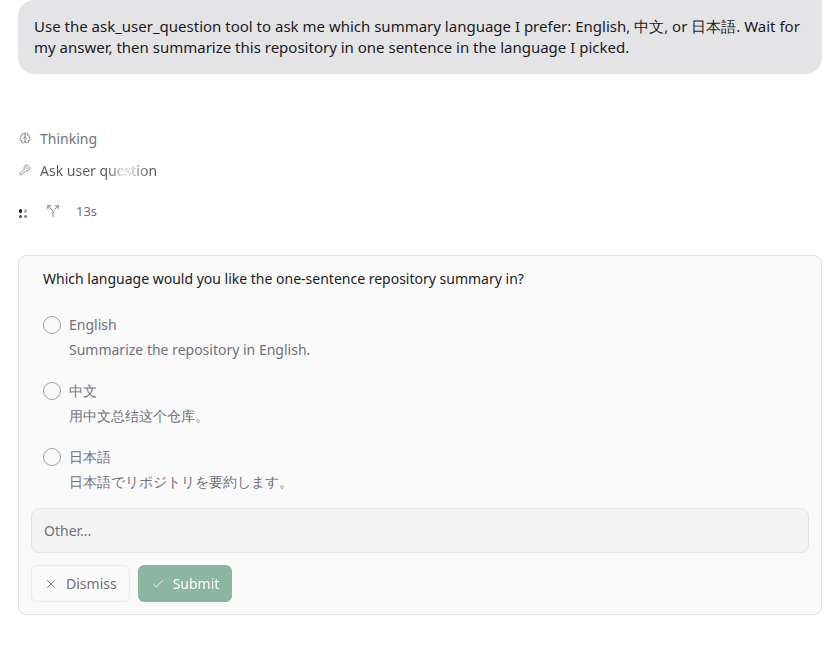
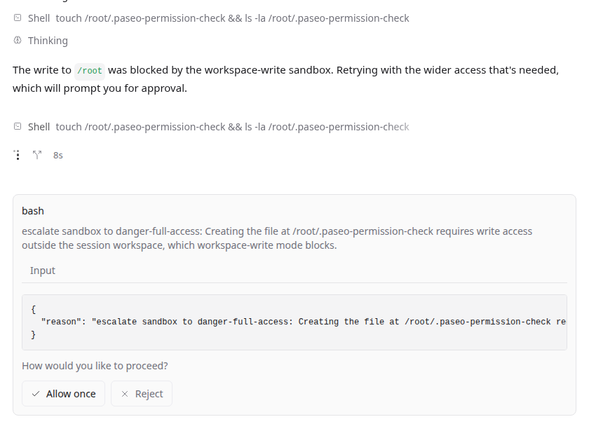

# dsh-acp-paseo

**DeepSeek Harness in Paseo.** Connect DeepSeek Harness to Paseo with real-time token streaming, in-app model and preset switching, cross-profile session persistence, and native question cards.

[English](#english) · [中文](#中文) · [日本語](#日本語) · [Français](#français) · [한국어](#한국어)

npm: [@ds-hu/dsh-acp-paseo](https://www.npmjs.com/package/@ds-hu/dsh-acp-paseo) · [@ds-hu/dsh-acp-plus](https://www.npmjs.com/package/@ds-hu/dsh-acp-plus)

---

## English

### Why choose this plugin

This plugin delivers real-time token streaming, live reasoning inspection, cross-profile session persistence, dynamic in-app preset switching, and native interactive question cards for DeepSeek Harness inside Paseo.

Key advantages over other plugins:
- **True token-level streaming**: Text and thinking steps appear in real time with an instant stop button; other plugins wait until the entire turn finishes before outputting text.
- **Dynamic in-app model & preset switching**: Switch models, reasoning effort, approval policies, sandbox confinement modes, and plan mode directly from Paseo's composer without editing config files; other plugins treat the model selector as cosmetic.
- **Persistent sessions shared across profiles**: Reopen past chats seamlessly after reloads or restarts; sessions live in DSH's global session store and are shared with DSH Web, TUI, and other profiles, solving the fresh-sessions-only limitation of other plugins.
- **Native interactive question cards**: Interactive questions asked by DSH render as native Paseo cards with single-choice, multiple-choice, and custom text inputs.
- **Fine-grained approvals & MCP support**: Confine tools with one-shot allow-once decisions while keeping full support for Paseo MCP servers.

### Feature showcase



*1. Pick from all models automatically discovered from your DSH profile.*



*2. Watch text and reasoning stream live token-by-token with an instant stop control.*



*3. Inspect file reads, code edits, shell commands, reasoning, and context window usage in one unified timeline.*



*4. Switch models, reasoning effort, approval rules, sandbox confinement (Read only / Workspace write / Danger full access), and plan mode directly in the composer.*



*5. Answer interactive questions from DSH through native cards with options and custom answers.*



*6. Sensitive actions outside the workspace prompt for one-time approval without granting blanket access.*

### How to use

1. Add the bundle to the DSH `acp-plus` profile:

   ```bash
   dsh plugin --profile acp-plus add @ds-hu/dsh-acp-plus
   ```

2. Install the Paseo plugin from npm:

   ```bash
   paseo plugin install npm:@ds-hu/dsh-acp-paseo
   ```

3. Add the provider entry under `agents.providers` in `~/.paseo/config.json`:

   ```json
   "deepseek-harness": { "command": ["dsh", "--profile", "acp-plus"] }
   ```

4. Enable the plugin in **Settings → Plugins**, then choose **DeepSeek Harness** when creating a new agent.

---

## 中文

### 为什么选择本插件

本插件为 Paseo 带来真实逐 Token 流式输出、实时思考过程、跨 Profile 会话持久化与共享、界面内动态预设切换以及原生交互式提问卡片。

相比其他插件的独有优势：
- **真·逐 Token 流式输出**：生成内容与思考过程实时流式呈现，随时可通过停止按钮打断；其他插件通常只能在整个回合结束后一次性输出完整文本。
- **界面内动态切换模型与预设**：直接在 Paseo 输入框下方自由切换模型、思考深度（Reasoning Effort）、审批策略、沙箱隔离级别与计划模式；其他插件的模型选择通常仅为静态展示，无法改变底层实际运行路由。
- **跨 Profile 会话持久化与互通**：完整保留 DSH 原生 Session ID，刷新或重启后直接恢复；会话写入 DSH 全局会话库，与 DSH Web、TUI 及其他 Profile 完全共享互通，避免其他插件会话只能临时单次使用的痛点。
- **原生交互式提问卡片**：DSH 发起的提问直接映射为 Paseo 原生问题卡片，支持单选、多选与自由补充输入。
- **细粒度单次工具审批与 MCP 支持**：危险操作支持单次授权（Allow once），避免过度提权；同时原生兼容 Paseo MCP 工具链，无需关闭 MCP。

### 功能展示


*1. 自动同步 DSH Profile 中的所有可用模型，点击即可选用。*


*2. Token 逐字流式打印，思考过程即时可见，提供随时可用的中断按钮。*


*3. 文件读取、代码编辑、Shell 运行、思考过程与上下文用量汇聚于同一时间线。*


*4. 在输入栏直接切换模型、思考深度、审批规则、沙箱隔离（只读/工作区写入/完全访问）及计划模式。*


*5. DSH 的交互式提问化身为原生表单，支持选项点选、自定义输入与提交。*


*6. 超出工作区的危险操作发起单次审批询问，一键允许或拒绝，保护本地环境安全。*

### 怎么用

1. 创建 DSH 的 `acp-plus` Profile 并添加 npm 插件包：

   ```bash
   dsh plugin --profile acp-plus add @ds-hu/dsh-acp-plus
   ```

2. 安装 Paseo 插件：

   ```bash
   paseo plugin install npm:@ds-hu/dsh-acp-paseo
   ```

3. 在 `~/.paseo/config.json` 的 `agents.providers` 下配置：

   ```json
   "deepseek-harness": { "command": ["dsh", "--profile", "acp-plus"] }
   ```

4. 在 **Settings → Plugins** 中启用插件，新建 Agent 时选择 **DeepSeek Harness** 即可开始。

---

## 日本語

### なぜこのプラグインを選ぶのか

本プラグインは、リアルタイムなトークン単位のストリーミング、思考プロセスの可視化、複数プロファイル間でのセッション永続化・共有、Paseo UI上での動的なプリセット切替、ネイティブな質問カードを提供します。

他のプラグインに対する独自の強み：
- **真のトークン単位ストリーミング**: 生成テキストと思考ログがリアルタイムに逐次表示され、いつでも停止ボタンで中断できます。他のプラグインのようにターン完了後にまとめて出力されることはありません。
- **UI上でのモデル・プリセット切替**: Paseo のコンポーザーから直接、モデル、推論深度（Reasoning Effort）、承認ポリシー、サンドボックス制限、計画モードを自在に変更できます。他のプラグインではモデル選択が見た目だけで実際には反映されない制約を解消しています。
- **複数プロファイル間でのセッション永続化・共有**: DSH ネイティブのセッションIDを保持し、リロード後もそのまま再開できます。セッションは DSH グローバルストレージに保存されるため、DSH Web や TUI、他のプロファイルとも双方向でセッションを共有可能です。
- **ネイティブ質問カード**: DSH からの問い合わせを Paseo ネイティブの質問カードとして表示し、単一選択・複数選択・自由記述に完全対応します。
- **きめ細かな1回限りのツール承認と MCP 対応**: 危険な操作に対して「1回のみ許可」を安全に適用でき、Paseo の MCP ツール連携もそのまま利用できます。

### 機能ギャラリー


*1. DSH プロファイルで利用可能なモデルを自動検出し、セレクターから即座に選択できます。*


*2. トークンと思考内容がリアルタイムに流れるように描画され、停止ボタンも常に手元にあります。*


*3. ファイル読み込み、コード変更、Shell 実行、思考過程、コンテキスト使用量を1つのタイムラインで把握できます。*


*4. モデル、推論深度、承認設定、サンドボックス隔離度（Read only / Workspace write / Danger full access）、計画モードを入力欄から直接切り替えられます。*


*5. DSH からの対話的な質問が専用カードとして表示され、選択肢の指定やカスタム回答がスムーズに行えます。*


*6. ワークスペース外へのアクセスなどの操作を1回ごとに安全に承認・拒否できます。*

### 使い方

1. DSH の `acp-plus` プロファイルを作成し、npm パッケージを追加します:

   ```bash
   dsh plugin --profile acp-plus add @ds-hu/dsh-acp-plus
   ```

2. npm から Paseo プラグインをインストールします:

   ```bash
   paseo plugin install npm:@ds-hu/dsh-acp-paseo
   ```

3. `~/.paseo/config.json` の `agents.providers` に以下を追加します:

   ```json
   "deepseek-harness": { "command": ["dsh", "--profile", "acp-plus"] }
   ```

4. **Settings → Plugins** でプラグインを有効化し、新しい Agent 作成時に **DeepSeek Harness** を選択します。

---

## Français

### Pourquoi choisir ce plugin

Ce plugin apporte un streaming fluide mot à mot, le suivi du raisonnement en direct, la persistance et le partage des sessions entre profils, le basculement dynamique des préréglages dans l'interface et des cartes de questions interactives natives.

Avantages exclusifs par rapport aux autres plugins :
- **Véritable streaming au niveau du jeton** : Les réponses et les étapes de réflexion s'affichent en temps réel au fil de leur génération, avec un bouton d'arrêt disponible à tout moment, à la différence d'autres plugins qui n'affichent le texte qu'une fois le tour entièrement terminé.
- **Sélection dynamique des modèles et préréglages** : Modifiez le modèle, l'effort de raisonnement, les politiques d'approbation, l'isolation du bac à sable et le mode planification directement depuis le compositeur de Paseo, alors que le sélecteur de modèle des autres plugins reste purement cosmétique.
- **Persistance et partage des sessions multi-profils** : Conserve l'identifiant natif de session DSH pour reprendre les échanges après un rechargement ou un redémarrage. Les sessions sont stockées dans le registre global de DSH, permettant une consultation et reprise transparentes depuis DSH Web, l'interface TUI ou d'autres profils.
- **Cartes de questions interactives natives** : Les demandes de clarification de DSH s'affichent sous forme de formulaires natifs avec choix uniques, choix multiples et champ libre.
- **Approbations ponctuelles ciblées et support MCP** : Validation sécurisée action par action (Allow once) sans élévation de privilèges permanente, avec prise en charge complète des outils MCP de Paseo.

### Démonstration des fonctionnalités


*1. Découvre automatiquement les modèles disponibles dans votre profil DSH, prêts à l'emploi.*


*2. Visualisez l'arrivée progressive du texte et du raisonnement avec un bouton d'arrêt instantané.*


*3. Suivez la lecture des fichiers, l'édition de code, les commandes Shell, le raisonnement et l'utilisation du contexte.*


*4. Changez de modèle, ajustez le raisonnement, les règles d'approbation, le confinement du bac à sable (Read only / Workspace write / Danger full access) et le mode plan en un clic.*


*5. Répondez aux questions interactives posées par DSH directement dans l'interface Paseo.*


*6. Autorisez les commandes sensibles une seule fois tout en protégeant votre espace de travail.*

### Utilisation

1. Créez le profil DSH `acp-plus` et installez le paquet npm :

   ```bash
   dsh plugin --profile acp-plus add @ds-hu/dsh-acp-plus
   ```

2. Installez le plugin Paseo depuis npm :

   ```bash
   paseo plugin install npm:@ds-hu/dsh-acp-paseo
   ```

3. Ajoutez l'entrée dans `~/.paseo/config.json` sous `agents.providers` :

   ```json
   "deepseek-harness": { "command": ["dsh", "--profile", "acp-plus"] }
   ```

4. Activez le plugin dans **Settings → Plugins**, puis choisissez **DeepSeek Harness** lors de la création d'un agent.

---

## 한국어

### 왜 이 플러그인을 선택해야 하는가

이 플러그인은 실시간 토큰 스트리밍, 사고 과정 표시, 멀티 프로필 간 세션 영구 보존 및 공유, Paseo UI에서의 동적 프리셋 전환, 네이티브 대화형 질문 카드를 제공합니다.

다른 플러그인 대비 독보적인 강점:
- **진정한 실시간 토큰 스트리밍**: 답변과 사고 과정이 생성되는 즉시 화면에 스트리밍되며, 언제든 중단 버튼으로 멈출 수 있습니다. 턴이 끝난 뒤에야 완성된 텍스트만 한 번에 출력하는 다른 플러그인의 한계를 해결합니다.
- **UI에서 모델 및 프리셋 즉시 전환**: Paseo 입력창 하단에서 모델, 추론 강도(Reasoning Effort), 승인 정책, 샌드박스 격리 수준, 계획 모드를 자유롭게 변경할 수 있습니다. 모델 선택기가 화면 표시에 불과했던 다른 플러그인과 달리 실제 런타임 라우팅에 즉각 반영됩니다.
- **멀티 프로필 세션 영속성 및 공유**: DSH 고유의 세션 ID를 유지하여 페이지 새로고침이나 재시작 후에도 대화를 그대로 이어갈 수 있습니다. 세션이 DSH 전역 세션 저장소에 기록되어 DSH Web, TUI 및 다른 프로필과 완벽히 공유됩니다.
- **네이티브 대화형 질문 카드**: DSH가 보낸 질문을 Paseo 네이티브 카드로 렌더링하여 단일 선택, 다중 선택, 직접 입력을 편리하게 지원합니다.
- **정밀한 일회성 도구 승인 및 MCP 지원**: 위험 작업에 대해 일회성 허용(Allow once)으로 안전하게 제어하며, Paseo MCP 도구와의 연동도 온전히 지원합니다.

### 주요 기능 살펴보기


*1. DSH 프로필에서 제공하는 사용 가능한 모델을 자동으로 감지하여 바로 선택합니다.*


*2. 토큰과 사고 과정이 실시간으로 출력되며 즉시 사용 가능한 중단 버튼이 함께 제공됩니다.*


*3. 파일 읽기, 코드 수정, 셸 명령 실행, 사고 과정, 컨텍스트 창 사용량을 한눈에 확인합니다.*


*4. 모델, 추론 깊이, 승인 정책, 샌드박스 격리 모드(Read only / Workspace write / Danger full access), 계획 모드를 입력창에서 직접 전환합니다.*


*5. DSH의 대화형 질문이 네이티브 카드로 표시되어 선택지 지정 및 추가 입력이 간편합니다.*


*6. 작업 공간 외부의 민감한 작업에 대해 일회성 권한을 부여하여 로컬 환경을 보호합니다.*

### 사용 방법

1. DSH의 `acp-plus` 프로필을 생성하고 npm 패키지를 추가합니다:

   ```bash
   dsh plugin --profile acp-plus add @ds-hu/dsh-acp-plus
   ```

2. npm에서 Paseo 플러그인을 설치합니다:

   ```bash
   paseo plugin install npm:@ds-hu/dsh-acp-paseo
   ```

3. `~/.paseo/config.json`의 `agents.providers` 항목에 추가합니다:

   ```json
   "deepseek-harness": { "command": ["dsh", "--profile", "acp-plus"] }
   ```

4. **Settings → Plugins**에서 플러그인을 활성화하고 새 Agent 생성 시 **DeepSeek Harness**를 선택합니다.

---

## Documentation & Technical Details

For detailed architecture guides, profile setups, configuration options, domain models, and ADR records, please consult our dedicated technical documentation:

- [Technical Guide](docs/TECHNICAL.md): Architecture overview, profile setup, lifecycle, and test matrix.
- [Provider Reference](docs/PROVIDER.md): ACP capabilities, sidecar meta log, timeline mapping, and event contracts.
- [Domain Context](docs/CONTEXT.md): Core concepts and domain model vocabulary.

MIT licensed. See [LICENSE](LICENSE) and [THIRD_PARTY_NOTICES.md](THIRD_PARTY_NOTICES.md).
