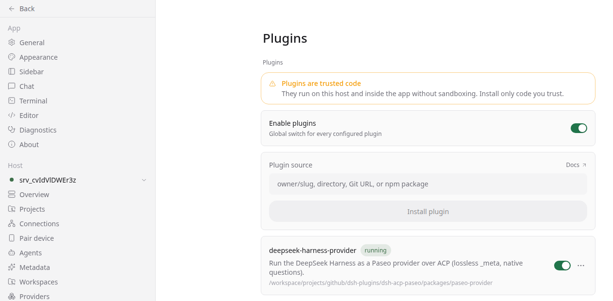

# Technical guide

The [README](../README.md) is the user-facing tour. This document covers the
architecture, profile setup, build commands and test matrix.

## Packages

| Package | Runs in | Job |
| --- | --- | --- |
| [`dsh-acp-plus`](../packages/dsh-acp-plus/README.md) | DSH process | Serves ACP v1 on stdio. Projects durable DSH events to standard ACP updates and mirrors the native payloads in `_meta.dsh` and `_dsh/*`. |
| [`paseo-provider-deepseek-harness`](../packages/paseo-provider/README.md) | Paseo daemon | Registers the `deepseek-harness` provider, launches `dsh --profile acp-plus`, renders the ACP projection and stores native payloads in a sidecar. |

Paseo loads plugin modules from `client/`, `server/` or `shared/`. All provider
code lives in `packages/paseo-provider/server/`; `index.server.ts` is the entry.
A module placed directly under the plugin root, or under `src/`, fails Paseo's
plugin compiler.

## Turn flow

```text
Paseo Web / Desktop / mobile
        │  provider protocol
        ▼
paseo-provider-deepseek-harness  (Paseo daemon plugin)
        │  ACP v1 over stdio
        ▼
dsh --profile acp-plus           (one process per session)
        │  DSH session events
        ▼
DeepSeek Harness agent + model
```

The provider owns the Paseo session, the ACP client and the permission
round-trip. The DSH side owns the agent, the tool sandbox and the session log.
Paseo renders the standard ACP projection; it does not need to understand DSH
event names.

Every `_meta.dsh`, `_dsh/event` and `_dsh/frame` payload is appended verbatim to:

```text
${PASEO_HOME:-~/.paseo}/plugin-data/deepseek-harness/sessions/<sessionId>.meta.jsonl
```

Treat that file as sensitive: it contains the raw conversation and tool data.
The provider caps it at 64 MiB per session.

## Prerequisites

- Node.js 22.19 or newer
- pnpm 11
- DeepSeek Harness CLI (`dsh`)
- Paseo 0.12.0-beta.3 or newer

## Build and test

```bash
pnpm install
pnpm -r build
pnpm test                 # unit + contract tests, offline
pnpm test:integration     # real dsh --profile acp-plus on a throwaway DSH_HOME
```

Optional live checks:

```bash
DSH_ACP_LIVE=1 pnpm --filter dsh-acp-plus test:live
PASEO_E2E=1 pnpm e2e:paseo
```

The live test copies `.credentials.yaml` and `settings.yaml` into a throwaway
home. It never mutates the operator's DSH home.

## DSH profile

Create `~/.dsh/profiles/acp-plus/package.json` with a bundle stack that includes
the base, the ACP app and this bridge:

```json
{
  "name": "dsh-profile-acp-plus",
  "private": true,
  "dsh": {
    "profile": {
      "bundles": [
        "@deepseek-ai/dsh-base",
        "@deepseek-ai/dsh-acp-app",
        "dsh-acp-plus"
      ],
      "patchReload": "startup"
    }
  }
}
```

`@deepseek-ai/dsh-acp-app` supplies the `acpAppStartup` gate and inserts the
stock `acp` row that the bundle patch disables. Keep it in the list.

Link the bundle into the profile:

```bash
dsh plugin --profile acp-plus add /absolute/path/to/packages/dsh-acp-plus
```

Then confirm the profile starts and exits cleanly on EOF:

```bash
dsh --profile acp-plus </dev/null
```

The bridge claims stdio once per process, so `patchReload: "startup"` is the
right setting.

## Install the Paseo plugin

```bash
paseo plugin install /absolute/path/to/packages/paseo-provider
```

Enable plugins globally and configure the provider in `~/.paseo/config.json`:

```json
{
  "pluginsEnabled": true,
  "plugins": {
    "deepseek-harness-provider": {
      "source": "directory",
      "path": "/absolute/path/to/packages/paseo-provider",
      "enabled": true
    }
  },
  "agents": {
    "providers": {
      "deepseek-harness": {
        "enabled": true,
        "command": ["dsh", "--profile", "acp-plus"],
        "env": { "DSH_HOME": "/absolute/path/to/dsh-home" }
      }
    }
  }
}
```

The `env` block is optional. Use it when Paseo should launch DSH against a
dedicated home instead of the daemon user's default `~/.dsh`.

Apply the config with `paseo reload`, or restart the daemon:

```bash
paseo daemon restart
```

Check the result:

```bash
paseo plugin ls
paseo provider ls
paseo provider models deepseek-harness
```

The provider row should read `available`, and the model probe should return the
models configured in the DSH profile.



## Web UI smoke test

1. Open Paseo, add a project and create a workspace.
2. Create an agent and choose `DeepSeek Harness` in the model picker.
3. Send a prompt that reads a file, then confirm the tool call, assistant text
   and token usage appear in the timeline.
4. Ask the agent to use `ask_user_question`; answer the card and confirm the
   turn continues.
5. Trigger a shell command outside the workspace; confirm the one-shot
   `Allow once` / `Reject` card, then reject it.
6. Reload the page and confirm the session reopens with its history.

The screenshots in the main README were produced with this flow against
`paseo 0.12.0-beta.3` and a local DeepSeek Harness profile.

## Provider surface

- Models and thinking options come from ACP `configOptions`.
- Approval policy, sandbox mode and plan mode are forwarded unchanged.
- A `session/load` replays history in seq order; `replayLimit` caps it.
- Questions use `_dsh/user_questions` and become Paseo question cards.
- Tool permissions use `session/request_permission` and are one-shot.
- Session persistence stores `nativeSessionId`, `dshCwd` and the sidecar
  pointer.

The full ACP method table, `_meta` envelope and extension list live in
[`packages/dsh-acp-plus/README.md`](../packages/dsh-acp-plus/README.md).

## Design records

- [`docs/CONTEXT.md`](CONTEXT.md): domain vocabulary
- [`docs/adr/0001-self-written-acp-bridge.md`](adr/0001-self-written-acp-bridge.md)
- [`docs/adr/0002-meta-envelope-and-event-mirror.md`](adr/0002-meta-envelope-and-event-mirror.md)
- [`docs/adr/0003-paseo-direct-provider-registration.md`](adr/0003-paseo-direct-provider-registration.md)
- [`docs/adr/0004-store-dont-render.md`](adr/0004-store-dont-render.md)
- [`docs/adr/0005-one-shot-permissions-and-question-fallback.md`](adr/0005-one-shot-permissions-and-question-fallback.md)

## Repository layout

```text
packages/dsh-acp-plus/    DSH bundle, ACP v1 agent, unit and integration tests
packages/paseo-provider/  Paseo plugin: index.server.ts + server/ + test/
contract/                 JSON Schema and fixtures for the _meta/_dsh contract
docs/                     context, ADRs, screenshots, this guide
scripts/e2e-paseo.sh      flag-gated real end-to-end run
```
